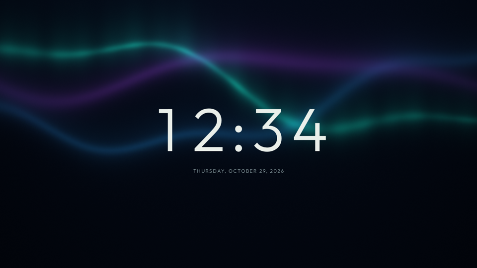

# Aurora Clock

A small standalone **PS5 homebrew proof of concept**: a clock over an animated aurora, launched from its own tile in **Games**. It demonstrates an application entrypoint, native display buffers, controller input, embedded assets, and normal exit—not a launcher or an exploit.



*Preview generated from the same scene renderer on a desktop; not a console screenshot.*

## Scope and status

- Native PS5 VideoOut, with no SDL, browser, network server, or Homebrew Launcher dependency at runtime.
- Fixed 1920×1080 output, CPU-rendered aurora and text, approximately 30 FPS target.
- 24-hour hours/minutes and an English date, read through platform `time()` / `localtime_r()`; no system-clock or timezone changes.
- Circle or Options closes the app. Release the launching button before pressing an exit button.
- Verified on one jailbroken PS5 using ShadowMountPlus 1.7beta7: visible rendering, 468 frames in the recorded run, main returning 0, and no logged cleanup errors. This is **not** a firmware compatibility matrix or an extended soak test.

This is unofficial homebrew, **not** an official Sony SDK application, retail-installable package, or a jailbreak installer. You need an existing compatible jailbroken console and a native-title loader. No proprietary SDK, firmware libraries, keys, games, or exploits are supplied. Use at your own risk; early native experiments encountered crashes, and unsupported console/runtime combinations can fail.

## Build from source

### Requirements

The exercised host is Apple Silicon macOS. The upstream kit also targets Linux/WSL; that path has not been exercised for this project.

- Python 3.9+, Git, Bash 4.4+, Ninja, Make, wget, unzip, tar.
- LLVM/Clang 18 (including `llvm-config`, `llvm-ar`, `llvm-readelf`, and LLD).
- A C++20 host compiler.
- GNU coreutils and diffutils on macOS. BSD tools/macOS Bash 3.2 are not sufficient.
- Internet access on first build for the public kit's pinned SDK v0.42 and zlib downloads. Downloads are checked by the upstream setup scripts.

On macOS with Homebrew and Xcode Command Line Tools installed:

```sh
brew install bash llvm@18 lld ninja make wget coreutils diffutils
export PATH="$(brew --prefix coreutils)/libexec/gnubin:$(brew --prefix diffutils)/libexec/gnubin:$(brew --prefix)/bin:$PATH"
export CXX=/usr/bin/clang++
```

Clone the **verified build-kit revision**, preferably next to this repository:

```sh
git clone https://github.com/MiladRTX/ps5-homebrew-starter.git ../ps5-homebrew-starter
git -C ../ps5-homebrew-starter checkout --detach c3f939230aee18863da1f359e39eb43bf95a056d
```

From this repository, build on macOS:

```sh
python3 tools/build_native.py \
  --kit ../ps5-homebrew-starter/kit \
  --clang "$(brew --prefix llvm@18)/bin/clang" \
  --llvm-config "$(brew --prefix llvm@18)/bin/llvm-config"
```

With the matching tools on PATH (for example on Linux), the equivalent command is:

```sh
python3 tools/build_native.py --kit ../ps5-homebrew-starter/kit
```

The script uses a temporary, owned source-staging directory inside the kit. The upstream kit also writes its own `build`, `dist`, and dependency cache: use a dedicated checkout and do not run builds concurrently in it. An arbitrary `--kit` checkout is accepted; the revision above is the documented verified input, not automatically enforced. This is a reproducible recipe, not a promise of byte-identical application binaries across hosts.

Outputs:

- `dist/PPSA99840/` — native title directory.
- `dist/AuroraClock-PS5.zip` — title-directory archive, **not a Sony retail PKG**.
- `dist/SHA256.json` — checksums of the packaged app files.

The kit rebuilds/validates its GPL clean-room `sce_module/libc.prx` loader companion; it is not copied from a game or Sony SDK. Its pinned SHA-256 is `e6ff45d16adf687855cc3b33b0c8a4132b6504360b221e0a34c7e99fb3ba0036`. This module is not a complete libc: do not assume an exported API has full semantics merely because linking succeeds.

The build does not connect to or install anything on a console.

## Install and run

1. Close any existing Aurora Clock instance.
2. Check that title ID **PPSA99840** is unused, or belongs to this app. Do not overwrite another title.
3. For the tested ShadowMountPlus directory workflow, copy the complete `dist/PPSA99840` directory into the loader's configured homebrew scan directory (tested: `/data/homebrew/PPSA99840`). Preserve the ZIP's permission metadata; ensure the loader can read/traverse the directory and execute the title.
4. Use your loader's documented scan/registration flow, then launch **Aurora Clock** from Games.
5. Verify the clock and moving background; close with Circle or Options.

This project does not install or configure ShadowMountPlus. Do not copy files over system libraries, change jailbreak settings, or delete download containers to install it. `/user/download` and `download0.dat` are not cleanup targets.

## Code map

| File | Responsibility |
| --- | --- |
| `native_main.c` | Read local time, draw/present frames, pace the loop, request exit. Start here. |
| `scene.c`, `scene.h` | Platform-independent aurora, text layout, font and scaling caches; writes ARGB pixels. |
| `native_platform.c`, `.h` | VideoOut buffers, tiled scanout conversion, flip synchronization, controller input, resource teardown. |
| `native_lifecycle.c` | Process-local module loads, persistent diagnostics, shell-mediated termination. |
| `sce_sys/param.json`, `icon0.png` | Title identity and Games presentation. |
| `tools/build_native.py` | Native build and source packaging; no deployment. |
| `tools/embed_font.py` | Convert the bundled font into a compile-time header. |

The scene renders into a reusable linear ARGB framebuffer. The platform layer converts it into a tiled RGBA scanout buffer, submits the flip, and waits for retirement before buffer reuse. Exit closes VideoOut before unmapping/releasing its backing memory. No framebuffer allocations occur in the steady-state frame loop; scene/font caches are built on first draw.

To make another app, start with `native_main.c` and replace the `scene_*` drawing calls. Keep the platform lifetime ordering intact. Give the new app a distinct title ID/content ID and matching metadata in `sce_sys/param.json`; the build derives its output directory from that metadata. Example IDs are not globally reserved. If you change the title ID, also change the title-specific log filename in `native_lifecycle.c` to avoid sharing diagnostics with Aurora Clock.

## Diagnostics and known limits

The latest launch writes `/data/aurora-clock-PPSA99840-startup.log` when writable. The tested loader maps `/data` into the app sandbox. Logging is best-effort, truncates the previous launch, and records startup, first frame, errors, and exit—not every frame. No logs are uploaded. The source contains no console address or account credentials.

Useful markers: `First native clock frame presented`, `Aurora Clock exit: status=0`, and `main returned: 0x00000000`. Also inspect preceding cleanup messages: main's status alone does not prove teardown succeeded.

- Two 16 MiB direct-memory buffers plus an approximately 7.9 MiB CPU framebuffer are reserved, before font/scene caches.
- Only the initial user's controller is opened. User switching, device reinitialization, suspend/resume, and rest-mode recovery are not verified.
- The frame rate is a target, not a guarantee. No GPU renderer, resolution selector, seconds display, localization, or app-managed time synchronization is implemented.
- If the shell close request returns instead of terminating the app, the app posts a notification and waits for shell closure.
- The embedded font is trusted build input. `stb_truetype` is **not safe for arbitrary untrusted font files**.
- SDK v0.42 emits qualified `_Generic`/`isfinite` warnings with Clang 18. These are known upstream-header warnings, not hidden by the build.

## Source package and license

```sh
python3 tools/build_native.py --source-zip
```

This needs only Python and creates `dist/AuroraClock-Source.zip` from an explicit allowlist. It excludes generated executables, console logs, previews from experiments, and local configuration. It includes the documented preview image and vendored font/header. The separately pinned native kit is still required to build.

Application code is **GPL-3.0-or-later**, with retained upstream notices. The font is OFL-1.1; `stb_truetype` is used under its MIT option. See [LICENSE](LICENSE) and [THIRD_PARTY_NOTICES.md](THIRD_PARTY_NOTICES.md). Before distributing compiled packages, provide the applicable corresponding source/build inputs, including the public kit and dependencies; this source ZIP alone is not the complete corresponding source of every bundled runtime component.
